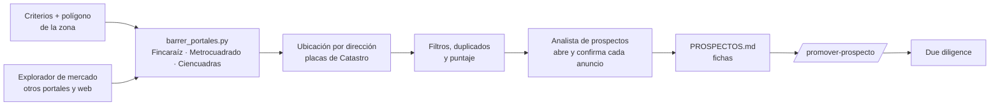
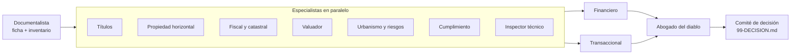

# Harness de due diligence inmobiliaria con agentes de IA — Bogotá

Un equipo de 14 agentes especialistas en [Claude Code](https://claude.com/claude-code) que **busca** apartamentos en Bogotá según los criterios del comprador y **revisa** un inmueble usado en propiedad horizontal antes de comprarlo.

- **Búsqueda**: barre los portales inmobiliarios, ubica cada anuncio por su dirección con el geocodificador oficial de Catastro Bogotá, lo cruza con una zona de interés dibujada como polígono, filtra por presupuesto (con gastos de cierre), área privada, parqueadero y piso, y mantiene un tablero de prospectos con historial de precios.
- **Due diligence**: lee los documentos del caso (certificados de tradición, escrituras, reglamento de PH, predial, cédulas), cruza la información con fuentes públicas y termina en un dictamen del comité:

**COMPRAR · COMPRAR CON CONDICIONES · NEGOCIAR · NO COMPRAR**, con precio de apertura, objetivo y retiro, condiciones para la promesa y pendientes ordenados por etapa.

> No sustituye a un abogado, un avaluador certificado (RAA) ni un ingeniero. Sirve para llegar a ellos con las preguntas correctas y saber cuándo un hallazgo exige su intervención.

## Cómo trabaja

### Búsqueda



| Paso | Quién | Produce |
|---|---|---|
| 0 | Coordinador (`/buscar-inmuebles`) | Criterios (presupuesto → precio máximo de compra) y la zona como polígono GeoJSON, con vértices calculados a partir de las vías y los humedales de OpenStreetMap, validado contra los sectores catastrales |
| 1 | [`barrer_portales.py`](harness/scripts/barrer_portales.py) | Anuncios normalizados (área privada y construida, piso, garajes, administración, coordenadas), filtros duros, duplicados entre portales, puntaje preliminar y registro con historial de precios |
| 1 | [`zona.py`](harness/scripts/zona.py) | Dirección → punto oficial (capa de placas domiciliarias de Catastro) → barrio catastral y dentro / borde / fuera del polígono. Las coordenadas de los portales suelen ser el centro del barrio; manda la dirección |
| 2 | `explorador-mercado` | Anuncios de fuentes que el script no cubre |
| 3 | `analista-prospectos` | Abre cada anuncio, confirma área sin balcón, tipo de parqueadero y piso, marca banderas y deja una ficha con las preguntas del primer contacto |

### Due diligence



| Fase | Agente (`.claude/agents/`) | Produce |
|---|---|---|
| 1 | `documentalista` | Ficha del inmueble e inventario documental (qué hay, qué falta, vigencias) |
| 2 | `abogado-titulos`, `analista-propiedad-horizontal`, `analista-fiscal-catastral`, `perito-valuador`, `analista-urbano-riesgos`, `oficial-cumplimiento`, `inspector-tecnico` | Un informe por especialidad, en paralelo |
| 3 | `analista-financiero`, `abogado-transaccional` | Costo total y escenarios de crédito; condiciones de la oferta y cláusulas de la promesa |
| 4 | `abogado-del-diablo` | Revisión adversarial: supuestos sin verificar, contradicciones, sesgos |
| 5 | `comite-decision` | Dictamen, scorecard, precios, condiciones y `pendientes.md` |

Hooks de Claude Code ([`.claude/hooks/proteger-datos.py`](.claude/hooks/proteger-datos.py)): bloquean escribir en los documentos originales de un caso, bloquean matrículas, CHIP y cédulas en cualquier archivo del harness público, y re-generan el tablero de prospectos cada vez que se edita el registro.

Reglas que siguen todos los agentes (detalle en [CLAUDE.md](CLAUDE.md)):

- **Evidencia o nada.** Cada afirmación cita su fuente (documento y página, anotación del certificado o URL con fecha). Lo que no tiene fuente queda como SUPUESTO o PENDIENTE.
- **Severidad explícita.** Cada hallazgo es `[BLOQUEANTE]`, `[ALTO]`, `[MEDIO]` o `[OK]`.
- **Verificado no es lo mismo que por verificar.** Lo que requiere bases restringidas (VUR, Rama Judicial, listas restrictivas) se deja como procedimiento en `pendientes.md`. No se da por bueno.
- **Las cifras normativas tienen año.** Tarifas, UVT y tasas se consultan con fecha o se toman de `harness/conocimiento/` con advertencia.

## Requisitos

- [Claude Code](https://claude.com/claude-code). Los agentes y skills se cargan solos desde `.claude/`.
- macOS con `zsh` y `python3`. El OCR de PDFs escaneados usa Apple Vision; el entorno virtual se crea solo la primera vez.
- Node.js (`npx`), solo si quieres exportar informes a PDF.

## Primeros pasos

### 1. Prepara el directorio privado de casos (una sola vez)

```bash
harness/scripts/inicializar_casos.sh            # por defecto crea ../<esta-carpeta>-casos
```

Los casos tienen documentos de identidad, escrituras y tus finanzas, así que **nunca** viven dentro de este repo. El script:

- crea el directorio de casos **fuera** del repo y lo enlaza como `casos/` (el symlink está en `.gitignore`);
- lo inicializa como un **repositorio Git local y sin remoto**, para que tengas la traza de cada cambio del análisis;
- copia las plantillas de `perfil-comprador.md` e `INDICE.md`;
- activa el hook [`harness/git-hooks/pre-commit`](harness/git-hooks/pre-commit), que bloquea commits del repo público con rutas de casos, PDFs, imágenes, matrículas o CHIP catastrales.

Después llena `casos/perfil-comprador.md` (objetivo, horizonte, ahorro, ingresos, crédito). Sin él, el análisis financiero trabaja con supuestos.

### 2. Busca (opcional)

```
/buscar-inmuebles presupuesto <N> M con gastos, mínimo <A> m² privados, con parqueadero, piso alto, zona entre <vías o barrios>
```

Deja en `casos/prospectos/` los criterios, el polígono, cada barrido (`barridos/<fecha>/`), el registro y el tablero `PROSPECTOS.md`. Para cambiar el estado de un prospecto (contactar, visitar, descartado…) se edita `registro.json`; el hook re-genera el tablero. Cuando uno pase la visita:

```
/promover-prospecto fr-123456789
```

crea el caso con `oferta.md` prellenada desde el anuncio y dice qué documentos pedir.

### 3. Crea un caso

En Claude Code, dentro de esta carpeta:

```
/nuevo-inmueble apto-chapinero
```

Se crea `casos/apto-chapinero/` y el caso se registra en `casos/INDICE.md`. Después:

1. Copia los PDFs en `casos/apto-chapinero/documentos/`. Como mínimo: certificado de tradición de **cada** matrícula (apartamento, garaje, depósito), escritura con la que compró el vendedor, reglamento de PH, predial del año y cédulas de los vendedores. La lista completa está en [checklist-documentos.md](harness/plantillas/checklist-documentos.md).
2. Llena `casos/apto-chapinero/oferta.md`: precio pedido, administración, quién vende y notas de la visita.

### 4. Analiza

```
/analizar-inmueble apto-chapinero
```

El coordinador extrae el texto de los PDFs (con OCR si hace falta) y lanza las 5 fases. Un análisis completo tarda del orden de decenas de minutos, según el tamaño del reglamento. Al final tendrás:

| Archivo | Para qué |
|---|---|
| `99-DECISION.md` | Dictamen, precios, condiciones y respuesta al abogado del diablo |
| `pendientes.md` | Lo que falta, ordenado por etapa (antes de oferta, de promesa, de escritura) y por responsable |
| `analisis/10…90-*.md`, `revision/95-*.md` | Informe de cada especialista |
| `README.md` | Estado del caso y enlaces |

### 5. Itera

Cuando llegue un documento nuevo, hagas la visita o cambie el precio:

```
/analizar-inmueble apto-chapinero solo:analista-propiedad-horizontal   # re-ejecuta un rol y luego el comité
git -C casos diff                                                       # qué cambió, sin releer todo
git -C casos add -A && git -C casos commit -m "apto-chapinero: llega paz y salvo, actualiza PH"
```

Con varios casos analizados, `/comparar-inmuebles` arma un ranking ponderado según tu perfil.

## Estructura

```
.
├── CLAUDE.md               reglas del harness para todos los agentes
├── .claude/agents/         un archivo por rol (14)
├── .claude/skills/         /buscar-inmuebles, /promover-prospecto, /nuevo-inmueble, /analizar-inmueble, /comparar-inmuebles
├── .claude/hooks/          protección de datos y tablero de prospectos al día
├── harness/conocimiento/   marco legal, costos de transacción en Bogotá, señales de alerta, fuentes de verificación, búsqueda
├── harness/plantillas/     ficha, informe de decisión, oferta, perfil, checklists, criterios de búsqueda, ficha de prospecto
├── harness/scripts/        inicializar_casos, nuevo_inmueble, extraer (texto + OCR), md2pdf, barrer_portales, zona
├── harness/git-hooks/      pre-commit que protege el repo público
├── notes.md                el prompt con el que empezó este proyecto
└── casos → ../…-casos      (no versionado aquí) repo privado con tus casos
```

## Cómo nació

[notes.md](notes.md) tiene el pedido original: cinco líneas pidiendo un harness con roles expertos para decidir si comprar un apartamento en Bogotá. Todo lo demás (los roles, las reglas de evidencia, la revisión adversarial y el comité) se diseñó con Claude Code a partir de ese pedido y se probó con un caso real, que queda fuera de este repositorio.

## Licencia

© 2026 Jofre Manchola. Todos los derechos reservados. Ver [LICENSE](LICENSE).
